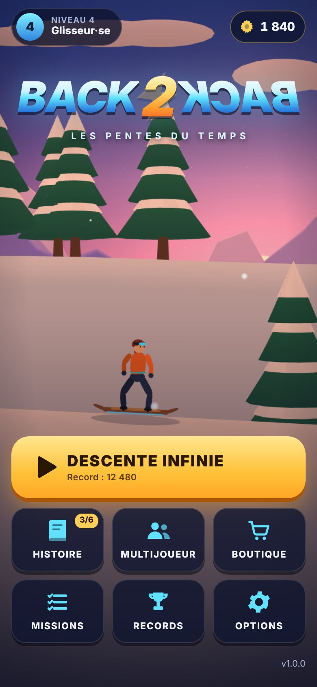
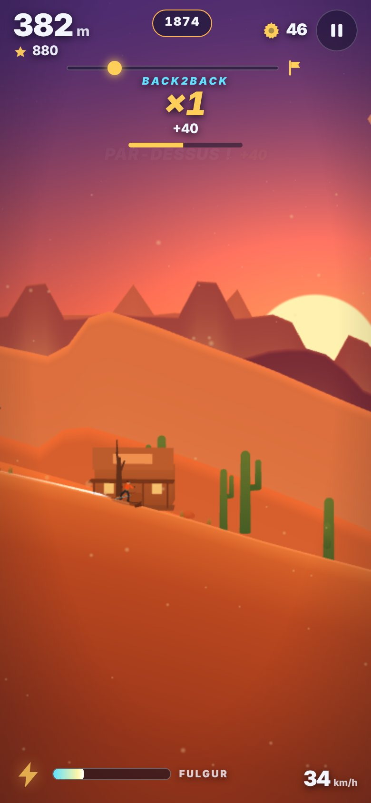
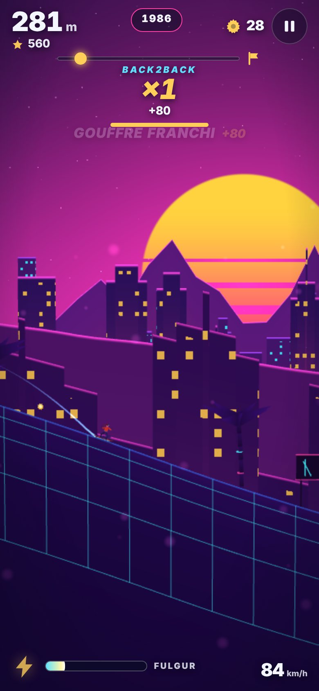
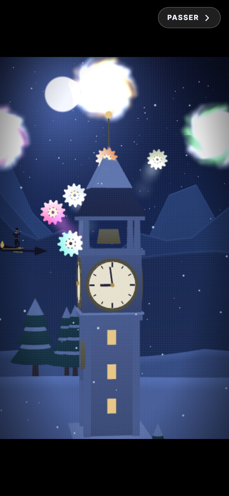

<h1 align="center">BACK2BACK</h1>
<p align="center"><b>Les Pentes du Temps</b><br>Un jeu de glisse contemplatif à travers les époques : une pente sans fin, un seul doigt, des figures à enchaîner dos à dos… et des portails qui vous envoient du Crétacé à l'an 2187.</p>
<p align="center"><sub>Statut : <b>Jouable</b> · PWA installable · hors ligne · multijoueur</sub></p>

<p align="center">
  
  
  
  
</p>

> **Pensé pour le téléphone.** C'est une application web installable (PWA) : ouvrez-la sur votre mobile, ajoutez-la à l'écran d'accueil, jouez hors ligne. Elle fonctionne aussi sur ordinateur (clic ou barre d'espace).

---

### L'idée

La nuit de l'orage, la Grande Horloge de Méridien vole en éclats et ses cinq Rouages sont projetés à travers le temps. Nova, apprentie horlogère, saute sur la **Fulgur** — une planche qui glisse sur les pentes du temps — pour aller les chercher, un par un.

Un hommage aux grandes aventures de voyage dans le temps, dans un univers, des personnages et des musiques entièrement originaux.

### Ce qu'il y a dans le jeu

- **Une seule commande.** Toucher pour sauter, maintenir en l'air pour un salto arrière, relâcher avant d'atterrir.
- **Back-to-back.** Chaque figure réussie donne un boost ; enchaînées sans temps mort, elles multiplient les points et chargent la jauge. Jauge pleine : **mode Fulgur** (vitesse folle, invincible, aimant à éclats).
- **Sept époques.** Mont Méridien aujourd'hui, l'Ère des Géants, le Grand Ouest de 1874, l'Âge du Chrome de 1957, les Nuits Néon de 1986, Néo-Méridien en 2187 et la Fin des Temps. Chacune a ses décors, ses obstacles, sa météo, ses ambiances du jour à la nuit et sa musique. On passe de l'une à l'autre par des portails, dans un tunnel temporel.
- **Trois façons de jouer.** *Descente infinie* (score, missions, rangs), *Histoire* (six chapitres et leurs séquences animées, prologue et finale compris), *Multijoueur* (course en ligne jusqu'à quatre, ou contre l'IA hors ligne).
- **Tous les écrans.** Accueil, préparation de la descente, histoire, boutique (six glisseurs, six planches, atelier d'améliorations, bonus), missions, records, options (volumes, qualité, langue FR/EN, vibrations), comment jouer, crédits, pause, seconde chance, résultats.
- **Aucune donnée collectée.** Pas de compte, pas de publicité, pas de suivi : la progression reste sur l'appareil.

### Comment c'est fait

Tout est généré par le code — il n'y a **aucun fichier image, modèle ou son** dans le dépôt, hormis les icônes de l'application.

| Domaine | Réalisation |
| --- | --- |
| Rendu | [Three.js](https://threejs.org) (WebGL). Direction artistique en silhouettes : piste en dégradé, crêtes superposées qui se fondent dans la brume, aplats teintés par l'heure du jour, vraie profondeur et parallaxe. |
| Monde | Parcours procédural **déterministe** (même graine = même pente, indispensable au multijoueur), chargé par tronçons. |
| Personnages | Marionnettes animées par cinématique inverse, sans fichier d'animation. |
| Effets | Particules, traînées lumineuses, éclairs, météo calculée par le processeur graphique, tunnel temporel. |
| Audio | Web Audio : instruments synthétisés, séquenceur, neuf thèmes originaux écrits en degrés de gamme autour d'un même leitmotiv, bruitages. |
| Cinématiques | Petit moteur de séquences (plans, acteurs, effets, sous-titres) joué dans le monde du jeu. |
| Multijoueur | Serveur Node + WebSocket : salons à code, partie rapide, relais des positions. Chaque client simule la même pente. |
| PWA | Manifest, service worker (tout le jeu est mis en cache), installation, plein écran, vibrations, maintien de l'écran allumé. |

**Outils** &nbsp; `Three.js` `Vite` `Web Audio` `WebSocket` `PWA` `Node.js`

### Lancer le jeu

```bash
npm install
npm run dev        # jeu sur http://localhost:5173 + serveur multijoueur
```

Version de production (le serveur sert le jeu **et** le multijoueur) :

```bash
npm run build
npm start          # http://localhost:8787
```

Autres commandes : `npm test` (vérifications sans navigateur), `npm run build:single` (tout le jeu dans un seul fichier HTML, `dist-single/index.html`), `npm run icons` (régénère les icônes).

### Multijoueur

- **Course contre l'IA** : toujours disponible, même hors ligne.
- **En ligne** : il faut le serveur (`npm start`, ou le `Dockerfile` fourni). Une fois lancé, *Créer un salon* donne un code à quatre lettres à partager ; *Partie rapide* rejoint une course ouverte.
- Si le jeu est hébergé en statique (GitHub Pages), indiquez l'adresse de votre serveur dans *Multijoueur → Adresse du serveur*.

### Déployer

- **GitHub Pages** : le workflow `.github/workflows/deploy.yml` construit et publie le jeu à chaque push sur `main` (activer *Settings → Pages → Source : GitHub Actions*). Le jeu fonctionne depuis n'importe quel sous-dossier.
- **Avec le multijoueur en ligne** : déployer le conteneur (`Dockerfile`) sur un hébergeur Node (il écoute sur `PORT`).

### Structure

```
src/core      moteur de rendu, entrées, sauvegarde, textes FR/EN
src/world     parcours, époques, relief, modèles, objets de jeu
src/game      physique, partie, personnages, effets, missions, IA
src/audio     synthétiseurs, séquenceur, partitions
src/cine      séquences de l'histoire
src/ui        HUD, écrans, styles
src/net       client multijoueur
shared/       logique des salons (serveur et tests)
server/       serveur HTTP + WebSocket
```

### Mentions

Moteur 3D : Three.js (licence MIT). Tout le reste — décors, personnages, musiques, textes — a été créé pour ce jeu.

### English

**BACK2BACK — Slopes of Time.** A contemplative one-touch downhill game across the ages. Tap to jump, hold to backflip, chain tricks back to back to charge the Fulgur, ride through portals from the Cretaceous to the year 2187. Endless mode with missions, a six-chapter story with animated sequences, online races for up to four players (or against the AI, offline). Everything is generated by code: scenery, characters, effects, music and sounds. Installable PWA, playable offline, no data collected.
